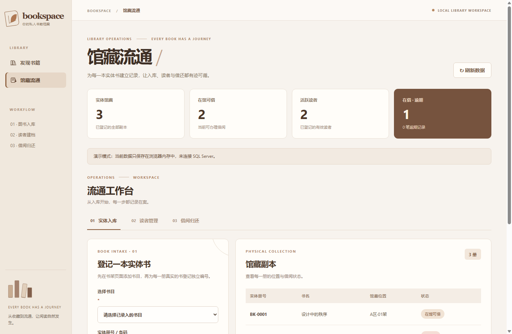
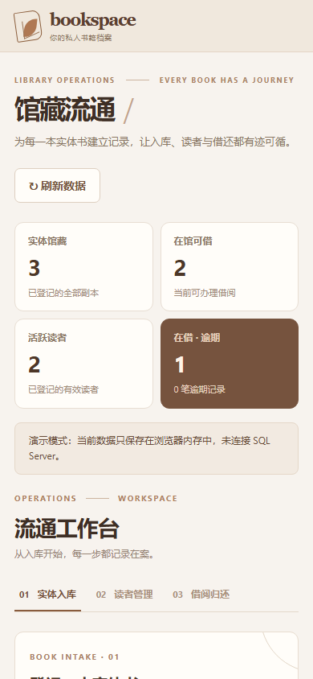

# BOOKSPACE · 我的可视化书库

基于 **ASP.NET MVC 5、Web API 2、C#、.NET Framework 4.7.2 和 SQL Server** 的可视化图书馆管理系统原型。以书籍封面为主视觉，结合馆藏副本、读者建档、借还书、续借及预约队列，保留可独立打开的离线交互演示。后端 SQL 事务尚未在真实数据库联调，不应当作已上线的生产系统。
## 界面与设计语言

采用**暖白书页 + 胡桃木棕**的书房风格，而非深色管理后台。基本色彩：背景 #F7F3EE、卡片 #FFFDF9、深文字 #3E2F25、次级文字 #7A6A5C、强调棕 #8B5E3C、深棕 #5C4030、分隔线 #E7DED4。桌面版采用窄导航与直接可见的书架，手机端改为双列书封；书籍焦点展示位于书架下方，不遮挡首屏书籍。

书封由**书名与分类稳定生成装饰性版式**，用于可视化浏览，**并非图书的真实出版封面**；不需要修改旧数据库表结构，也不依赖外部图片服务。

### 实际 Chrome 渲染预览

以上图片由项目页面在 Chrome 中渲染，使用**12 册明确标为演示用途的虚构示例书籍**，仅用于视觉与交互验证，不能作为真实 SQL Server 数据联调证据。

## 使用

提供封面书架/表格清单切换、关键词搜索、分类筛选、排序、点击书封查看详情、添加、编辑、删除书籍，以及加载、空列表、错误与重试状态。点击删除前会二次确认。

可直接在 Chrome 打开根目录的 __bookspace_demo.html 查看**本机交互演示**；演示用内存模拟接口，不会读取或写入真实数据库，刷新后恢复演示数据。该页面始终有「演示数据 · 未连接数据库」标识。

## 克隆与运行

**无需安装数据库即可体验前端。** 克隆仓库后，直接在浏览器打开根目录的 `__bookspace_demo.html`，点击「馆藏流通」即可进入 `__circulation_demo.html`。这两个页面通过内存模拟接口展示虚构书籍和读者，支持交互但不会持久化数据。

完整 C# 网站需要已有的 Visual Studio 2022（ASP.NET 和 Web 开发工作负载）、.NET Framework 4.7.2 开发工具及 SQL Server 环境。克隆后：

1. 在 `图书馆理模块` 项目文件夹复制 `Web.config.example` 为 `Web.config`，仅在本机修改 `BooksConnectionString` 指向正确的 SQL Server 实例。真实 `Web.config` 被 Git 忽略，不会进入仓库。
2. 打开根目录 `图书馆理模块.sln`，使用 Visual Studio 的 NuGet 还原功能还原 `packages.config` 中的依赖，**无需提交 `packages/`、`bin/` 或 `obj/`**。
3. 核对原数据库 `BookInfo`、`BookCategory` 表。如果使用全新的数据库，可审核后手动执行 `DATABASE_SETUP.sql`；馆藏业务的 V1/V2 脚本及安全限制见后文。请勿把测试脚本直接用于存有真实数据的数据库。
4. 通过 IIS Express 访问首页。图书 API 为 `/api/Books`、`/api/Categories`，馆藏流通工作台为 `/Circulation`。

**部署状态：** 已完成本机编译与模拟界面回归；未进行 SQL Server 实库迁移、借还事务联调，也未做生产安全加固。
## 已验证与未验证

- 通过 node --check 检查图书操作脚本语法。
- 通过 C# MSBuild 编译（由于当前机器缺失 Web Application targets，C# 检查使用临时最小 targets）；通过 ASP.NET 页面预编译。
- 通过 Chrome 的 1440、768、390、320 像素宽度布局复核，390px 无页面横向溢出，桌面五列、手机双列书架。
- 在本机**模拟接口**下实际验证书籍卡片、分类筛选、搜索、列表切换、详情与编辑，以及相关异常处理。

**尚未完成：** 真实 IIS Express 网站部署与 SQL Server 增删改联调。该课程项目也没有身份认证、角色权限、CSRF 保护与操作审计，未经加固不可把写入 API 直接暴露公网。

## 馆藏流通（第一阶段可研发原型）

新增独立的「馆藏流通」工作台，入口位于书架侧栏与顶部。未改变原 BookInfo / BookCategory 表结构，也不会自动生成实体库存。

图片由 Chrome 渲染真实页面，使用**虚构演示记录**，不是 SQL Server 业务数据。

### 业务流程

1. **书目入库**：从首页「添加书籍」创建 BookInfo。同一书目可以有多册实体书。
2. **实体登记**：在「实体入库」选择书目，为每一册设置唯一英数字条码和可选书架位置，生成 LibraryCopy。
3. **读者建档**：在「读者管理」登记姓名、唯一读者证号与可选联系方式，生成 LibraryReader。
4. **借阅**：选择在馆副本和有效读者，每笔借期 **14 天**，每人最多同时借 **5 册**。借出时记录借阅历史并修改副本状态。
5. **归还**：在借阅记录中确认归还，记录归还时间、恢复实体副本可借状态。超过到期日且未归还的记录会标记逾期。

模型：BookInfo → LibraryCopy → LibraryLoan ← LibraryReader。借阅和归还使用 SQL Server SERIALIZABLE 事务、锁与回滚，数据库还设有**每个实体副本最多一条未归还记录**的唯一过滤索引，防止重复借出。旧书目没有实体副本时不能借出，不会虚增库存。

### SQL Server 初始化（人工确认后才能执行）

新增 CIRCULATION_SCHEMA.sql；此文件**尚未执行**，编译、启动及打开演示页面也不会自动执行。

1. 在 SQL Server Management Studio 确认连接的是目标 Books 数据库，检查原 BookInfo 与 BookCategory 表结构。
2. 确认现有 LibraryReader、LibraryCopy、LibraryLoan 及同名约束/索引的实际结构。任何数据库脚本运行前应评估无法恢复的风险及可接受的恢复手段；当前开发未创建备份，也未执行脚本。3. 只对已确认的数据库环境，经审核后由管理员手动执行脚本；该脚本仅创建新表和索引，不删除或更新原书籍。如果旧库已经有同名表而结构不兼容，停止执行并制定迁移方案。
4. 新流通服务与原 BooksDataContext **共用 Web.config 中的 BooksConnectionString**，避免出现图书目录与借阅系统连接不同数据库的风险。

### 离线交互演示

使用 Chrome 打开项目根目录 __bookspace_demo.html，点击「馆藏流通」即可进入 __circulation_demo.html。演示页使用浏览器内存模拟登记、借阅、归还和服务故障，明确显示**未连接数据库**。刷新后示例数据恢复，不会写入真实馆藏。

实际服务路由：/Circulation，API 包括：
- GET /api/circulation/copies、POST /api/circulation/copies
- GET /api/circulation/readers、POST /api/circulation/readers
- GET /api/circulation/loans、POST /api/circulation/loans
- POST /api/circulation/loans/{id}/return

### 访问边界与验证

原课程系统尚无馆员登录、角色授权、审计和正式的防伪请求设计。新流通页面及私有读者数据 API 限制为**本机访问**，旧图书 API 的写入也限制为本机同源操作。这是临时保护，不代表生产级安全；**不得直接向互联网或不可信局域网开放**。

- C# 工程、ASP.NET 页面预编译和 JavaScript 语法检查通过。
- `Tests/Run-CirculationRulesSmoke.ps1` 已扩展为 39 项规则检查；Chrome 模拟数据回归覆盖读者、入库、借还、续借、预约、故障与恢复，390px 手机端无整体横向溢出。- **尚未验证**：真实 SQL Server 建表、数据库并发事务、读者实际数据及完整 IIS Express 网站部署。只读连接检查未成功，没有进行数据库写入。
- **尚未实现或实库验证**：正式通知、实体盘点、审计日志、馆员鉴权、生产级 CSRF 防护、服务端分页和真实 SQL Server 事务并发联调。
### 本机接口安全回归（2026-11）

由于尚未提供馆员登录和正式 CSRF 防护，写接口继续限制在本机使用，同时要求至少有一个有效且同源的 Origin 或 Referer；两个请求头同时存在时必须都匹配。没有来源信息的写入请求现在会被拒绝，防止以前“缺少头信息就放行”的行为。此机制只是开发阶段的临时限制，**无法防御能够伪造请求头的本机程序**，也不等于身份认证。

Tests/Run-CirculationRulesSmoke.ps1 现在包含 **22 项**独立 C# 检查（原有 11 项流通规则 + 11 项来源校验），并在本次修改后重新通过 C# 项目构建、ASP.NET 视图预编译和两份 JavaScript 语法检查。数据库连接失败时会主动释放未成功打开的连接；尚未在真正的 SQL Server 上验证连接失败恢复、事务并发或数据库状态。

## 馆藏流通 V2 · 读者、续借与预约

在 V1 实体入库、读者建档和借还书基础上，V2 已实现读者资料编辑、启用/停用、借阅续期、按书目预约及取消、预约队列优先办理借阅、逾期筛选。**每笔借阅最多续借一次（延长 14 天），已逾期或有其他读者排队时不得续借。** 有未归还实体书或未完成预约的读者不得停用；取消预约不删除历史；预约履约与实体借书在同一个 SQL 事务内提交或回滚。

### SQL 升级顺序与约束

1. 先确认目标为正确的 SQL Server `Books` 数据库，检查现有表和数据。使用原始库时先审核 `CIRCULATION_SCHEMA.sql`（V1）。
2. 在确实完成 V1 且核对旧库之后，人工审核 `CIRCULATION_UPGRADE_V2.sql`（V2）：为 `LibraryLoan` 增加默认 0 的 `RenewCount`，新增 `LibraryReservation`，补充约束、预约唯一过滤索引与查询索引；脚本包含旧数据兼容性检查，不删除旧书籍或借阅记录。
3. 当前电脑没有 SQL Server 实例，**V1/V2 脚本均未执行、未在真实 SQL Server 验证**。不自动安装软件或替换成另一种数据库。执行前需要操作者根据实际风险自行决定恢复手段；用户在当前开发工作中选择了不额外备份，本次未创建备份。

新增/升级 API（本机同源限制不变）：`PUT /api/circulation/readers/{id}` 修改读者、`POST /api/circulation/readers/{id}/status` 启停、`POST /api/circulation/loans/{id}/renew` 续借、`GET /api/circulation/loans/overdue` 逾期、`GET/POST /api/circulation/reservations` 预约、`POST /api/circulation/reservations/{id}/cancel` 取消。

`Tests/Run-CirculationRulesSmoke.ps1` 现包含 **39 项 C# 规则检查**（V1/来源校验 22 项 + V2 17 项）；`Tests/Run-CirculationBrowserSmoke.ps1` 使用已有 Chrome 进行虚构数据下的 **12 项重点界面回归**，涵盖读者编辑与启停、预约队列、预约优先借书、续借限制、取消预约、断线与恢复及 390px 手机端无整体横向溢出。上述测试证明代码逻辑和模拟接口表现，不证明 SQL Server 并发事务已经通过实库验收。生产使用仍需馆员认证、完整 CSRF 防护、审计与数据库实际联调。
