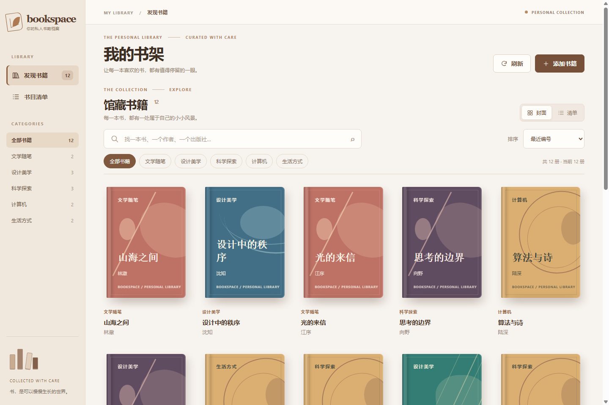
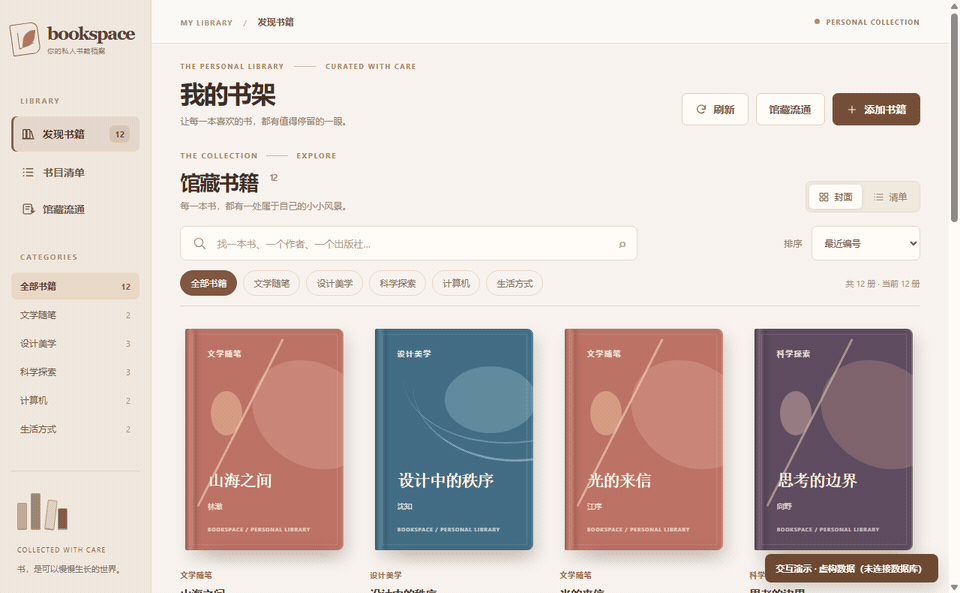
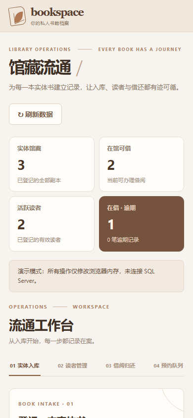
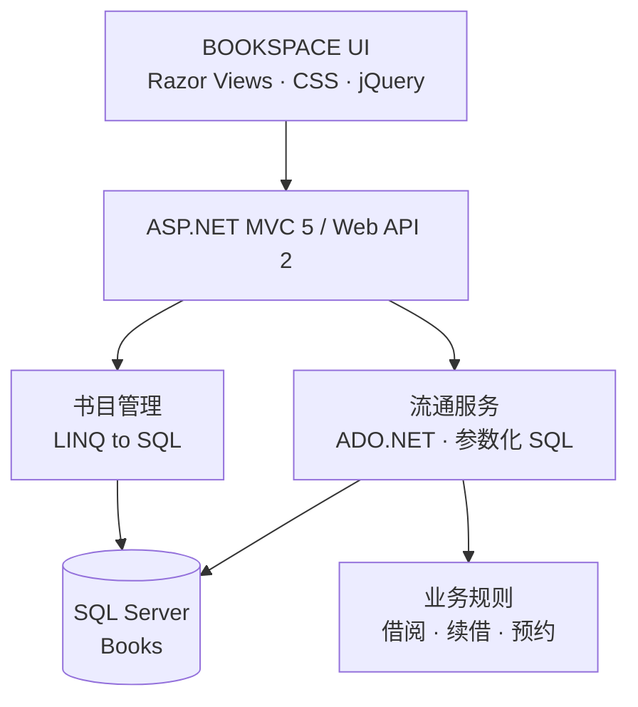

<p align="center">
  
</p>

<h1 align="center">BOOKSPACE</h1>

<p align="center"><strong>图书馆馆藏管理系统 · Library Collection Management System</strong></p>

<p align="center">
  面向图书馆的可视化馆藏管理平台，连接书目、实体副本、读者与流通记录。<br>
  从书目入库与馆藏检索，到借阅归还、续借及预约排队。
</p>

<p align="center">
  <code>ASP.NET MVC 5</code>&nbsp; <code>C#</code>&nbsp;
  <code>Web API 2</code>&nbsp; <code>SQL Server</code>&nbsp;
  <code>jQuery</code>
</p>

<p align="center">
  <a href="#产品预览">产品预览</a> ·
  <a href="#核心能力">核心能力</a> ·
  <a href="#快速开始">快速开始</a> ·
  <a href="#架构与数据模型">技术架构</a> ·
  <a href="#验证与项目状态">验证状态</a>
</p>

<p align="center">
  
</p>

> [!IMPORTANT]
> **当前为可交互的研发原型，不是已经上线的图书馆服务。** 书架与馆藏流通均有可运行的本地演示，但演示使用虚构数据和浏览器内存模拟接口；SQL Server 数据表尚未部署，借还事务尚未进行实库验证。

## 产品预览

### Discover / 以书为中心，而不是以表格为中心

<p align="center">
  
</p>

每本书都有独立的视觉封面：可按**书名、作者、出版社**检索，也可以按**分类、价格和编号**整理。点击书封展开详情，再进入编辑操作。封面由书目数据生成装饰性版式，**并非真实出版物封面**。

### In motion / 真实浏览器交互演示

<p align="center">
  
</p>

<sub>GIF 由本地 Chrome 对仓库中的离线页面实际操作录制，使用 <strong>12 本虚构示例书籍</strong>，保留「未连接数据库」提示；不代表真实 SQL Server CRUD 已完成联调。</sub>

### Circulate / 从书目到流通

<p align="center">
  
</p>

把“书目”和“实体书”区分开来：同一书目可以登记多册独立条码的馆藏副本，并记录读者、借还历史、续借次数与预约顺序。

<details>
  <summary><strong>查看更多界面：移动端馆藏书架、书籍详情与流通管理</strong></summary>

  <p align="center">
    
    &nbsp;&nbsp;
    
  </p>

  <p align="center">
    
  </p>
</details>

## 核心能力

| 领域 | 已实现的能力 | 当前验证 |
| :-- | :-- | :-- |
| **馆藏书目管理** | 可视化书封、分类筛选、搜索与排序、封面/清单视图、详情与书目增删改 | 本地 Chrome 交互 |
| **实体馆藏** | 书目关联多个实体副本、唯一条码、书架位置、在馆/借出状态 | 模拟交互 + SQL/C# 代码 |
| **读者档案** | 读者证号、资料维护、启用/停用；存在未还借阅或有效预约时不可停用 | 规则测试 + 模拟交互 |
| **借阅与归还** | 借阅历史、14 天借期、单人最多同时借 5 册、归还恢复副本状态 | 规则测试 + 模拟交互 |
| **续借与预约** | 最多续借一次、逾期和预约冲突限制、书目预约队列、取消与履约 | 规则测试 + 模拟交互 |
| **异常与边界** | 加载/空状态、服务错误与恢复、输入校验、事务回滚设计、同册重复借出约束 | 部分测试；实库待验证 |

设计原则：**让图书馆馆藏管理像浏览书架一样直观，同时保持实体副本与借阅记录的严谨性。** 系统采用暖白纸张、胡桃木棕与低饱和书封色彩；桌面优先展示书籍，移动端采用双列书架，尽量避免传统管理后台的厚重感。

## 快速开始

### 01 / 不连接数据库，直接体验界面

无需启动服务器，也不需要 SQL Server。拥有仓库访问权限后：

```bash
git clone https://github.com/musuixin01/bookspace.git
cd bookspace
```

用 **Chrome** 打开根目录的 `__bookspace_demo.html`。从界面导航进入「馆藏流通」，或直接打开 `__circulation_demo.html`。

演示数据只存在于浏览器内存，刷新后会恢复初始示例；**不会读取或写入真实数据库**。

### 02 / 在现有 ASP.NET 环境中运行项目

完整网站基于 **.NET Framework 4.7.2、ASP.NET MVC 5、Web API 2、LINQ to SQL / ADO.NET 和 SQL Server**。此步骤需要具备相应开发环境和可访问的 SQL Server：

1. 使用 Visual Studio 打开根目录的 `图书馆理模块.sln`，按 `packages.config` 还原 NuGet 依赖。
2. 复制 `图书馆理模块/Web.config.example` 为同目录的 `Web.config`，**仅在本机**设置 `BooksConnectionString`。实际配置文件已被 Git 忽略。
3. 先核对现有 `BookInfo` 与 `BookCategory` 表；仅在确认数据库环境后，人工审核相应 SQL 脚本。项目不会自动创建或迁移数据库。
4. 通过 IIS Express 访问书架首页，以及 `/Circulation` 馆藏流通工作台。

> 不要将课程原型直接部署到公网：当前没有正式的馆员身份认证、角色授权、完整 CSRF 防护与审计。限制本机访问及请求来源校验只是开发阶段的保护措施。

## 架构与数据模型



**数据关系：** `BookInfo`（书目）→ `LibraryCopy`（实体副本）→ `LibraryLoan`（借阅历史）；`LibraryReader`（读者）关联借阅和 `LibraryReservation`（预约）。借阅与归还使用 SQL Server 事务；针对同一实体副本的未还借阅设计了唯一过滤索引。

| SQL 文件 | 用途 |
| :-- | :-- |
| [`DATABASE_SETUP.sql`](DATABASE_SETUP.sql) | 原课程项目的初始数据库脚本；仅供审核后用于适当的测试环境 |
| [`CIRCULATION_SCHEMA.sql`](CIRCULATION_SCHEMA.sql) | V1：实体副本、读者、借阅表及约束 |
| [`CIRCULATION_UPGRADE_V2.sql`](CIRCULATION_UPGRADE_V2.sql) | V2：续借次数、预约队列、额外索引与兼容性检查 |

**升级顺序为 V1 → V2。** V2 脚本使用事务、增量检查与异常回滚，但两份脚本都**尚未在实际 SQL Server 上执行**；运行前须核对目标数据库、表结构及无法恢复的风险。

## 验证与项目状态

| 检查项目 | 结果 |
| :-- | :-- |
| C# 工程编译、ASP.NET Razor 页面预编译 | 通过（本机工具链，Web Application targets 使用临时编译兼容处理） |
| C# 业务与请求来源规则检查 | **39 项通过** |
| Chrome 离线演示回归（含预约、续借与异常恢复） | **12 项关键检查通过** |
| 桌面与 390px 手机端实际渲染 | 已检查 |
| SQL Server 实库建表、事务并发与数据持久化 | **未验证** |
| 生产级鉴权、审计与公网部署 | **未实现** |

复验入口：[`Tests/Run-CirculationRulesSmoke.ps1`](Tests/Run-CirculationRulesSmoke.ps1) · [`Tests/Run-CirculationBrowserSmoke.ps1`](Tests/Run-CirculationBrowserSmoke.ps1)。GIF 可在已有 Chrome、Node.js 与 FFmpeg 的开发环境中由 [`Tests/Record-ReadmeGif.ps1`](Tests/Record-ReadmeGif.ps1) 重新录制；不需要数据库。

## 项目结构

```text
BOOKSPACE/
├── assets/                         # 品牌 SVG、真实界面截图与演示 GIF
├── 图书馆理模块/                   # ASP.NET MVC / Web API 应用
│   ├── Controllers/               # 书目与馆藏流通接口
│   ├── Models/                    # 数据模型与 LINQ to SQL 映射
│   ├── Services/                  # 借阅规则、SQL 访问与并发控制
│   ├── Views/                     # Razor 页面
│   ├── Content/                   # 暖白与胡桃木主题样式
│   ├── Scripts/                   # 书架与流通工作台交互
│   └── Web.config.example         # 无个人连接信息的配置示例
├── Tests/                          # 业务规则、Chrome 回归、GIF 录制
├── DATABASE_SETUP.sql
├── CIRCULATION_SCHEMA.sql
├── CIRCULATION_UPGRADE_V2.sql
├── __bookspace_demo.html           # 离线书架演示
├── __circulation_demo.html         # 离线流通演示
└── 图书馆理模块.sln
```

---

<p align="center">
  <strong>BOOKSPACE</strong> · 图书馆馆藏管理系统 · Every book has a place.<br>
  <sub>当前为私有研发项目，未声明开源许可证。截图及 GIF 均来自虚构数据的本地演示，不代表 SQL Server 实库验收。</sub>
</p>
